# Quiet Banking redesign proposal

This is a generated visual reference for review, not an approved implementation contract. The existing [design baseline](../DESIGN.md) and [approved wireframes](../wireframes/manifest.json) remain authoritative. No application behavior changes in this package.

The 24 selected concepts are followed by eight detail views that appeared after generation timed out. Screens 25–32 are unreviewed. The earlier Stitch project `projects/16873688144152014118` remains preserved. The [manifest](manifest.json) records screen and file resource names and SHA-256 hashes. The [design system](DESIGN_SYSTEM.md) is a generated proposal.

Screens contain synthetic example data. Images are static; interactions, navigation, permissions, copy, financial accuracy, responsive behavior and accessibility have not been fully validated. Review keyboard and screen-reader behavior, focus, contrast, dynamic text, touch targets, errors and privacy states before implementation. Generated visuals can differ from real product capabilities and must not be treated as working features. Screen 17 was regenerated to repair a blank preview; its copy is also unverified.

Screens 25–26 and 32 include generated claims about zero-knowledge design, enclaves, Secure Element, security audits, recovery, air-gapped or offline operation, encrypted SQLite and credential handling. These are not verified product guarantees; remove or verify them before reuse.

## Screen gallery

### 01 Home Dashboard

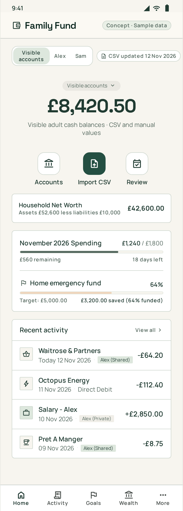

### 02 Accounts List

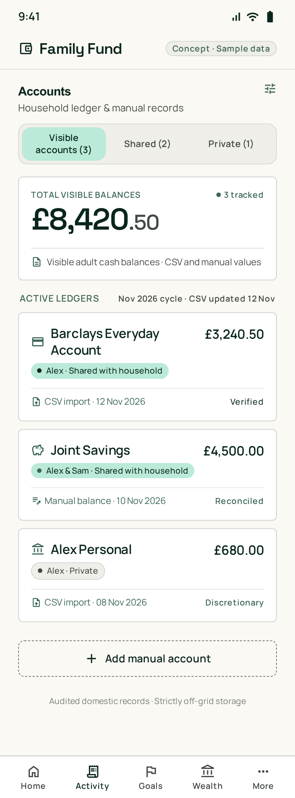

### 03 Account Detail

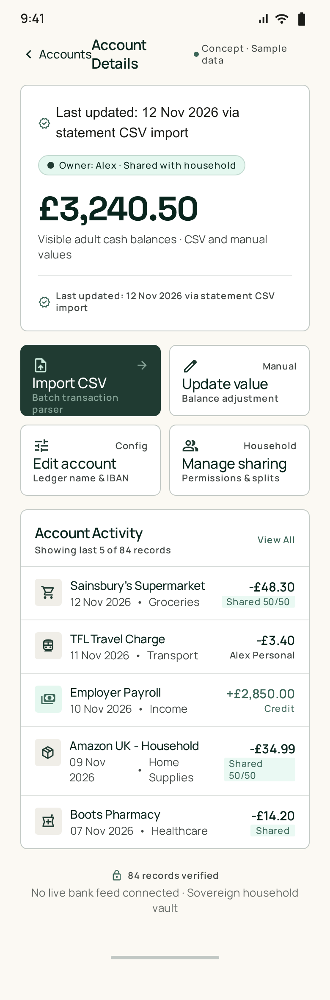

### 04 Activity Ledger

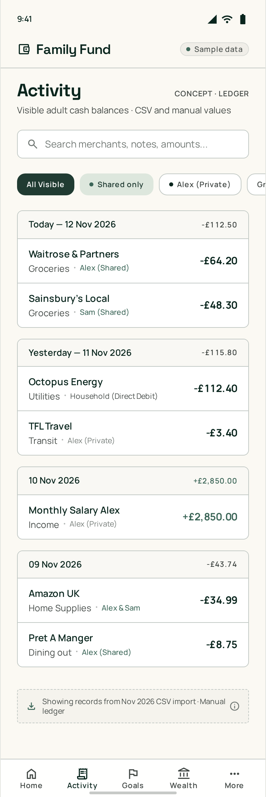

### 05 Transaction Detail

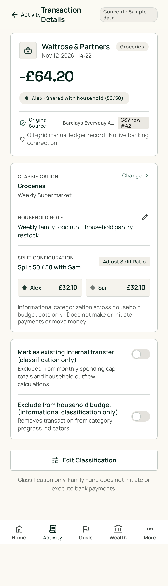

### 06 CSV Import Review

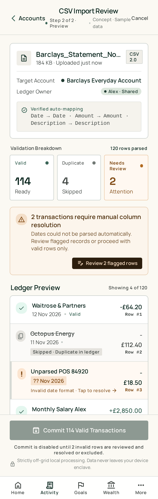

### 07 Spending Plan

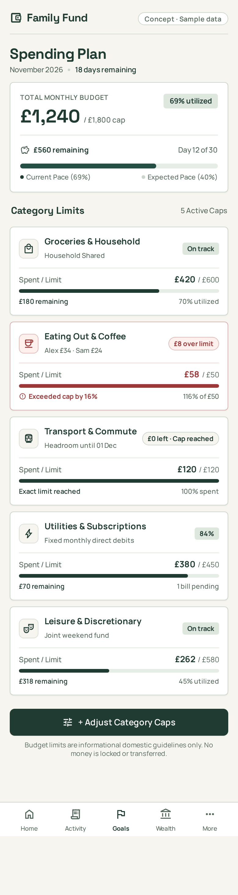

### 08 Monthly Review

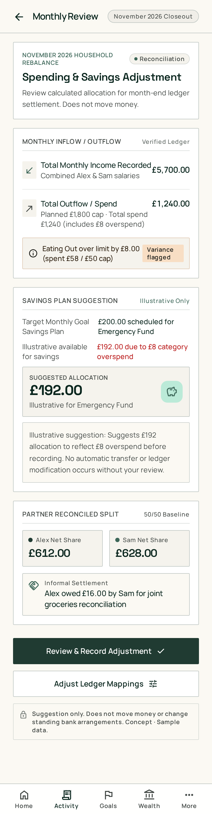

### 09 Recurring Commitments

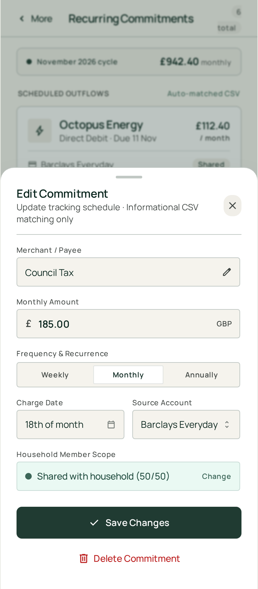

### 10 Goals Overview

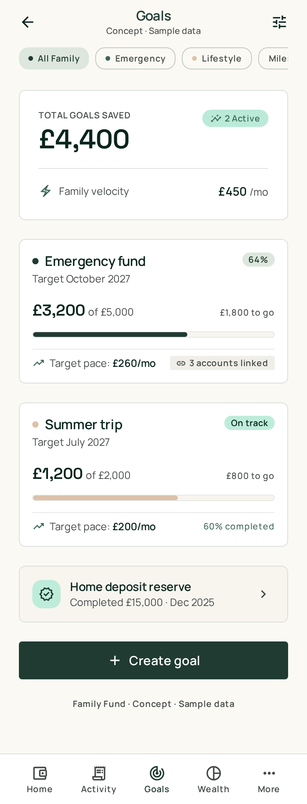

### 11 Goal Detail

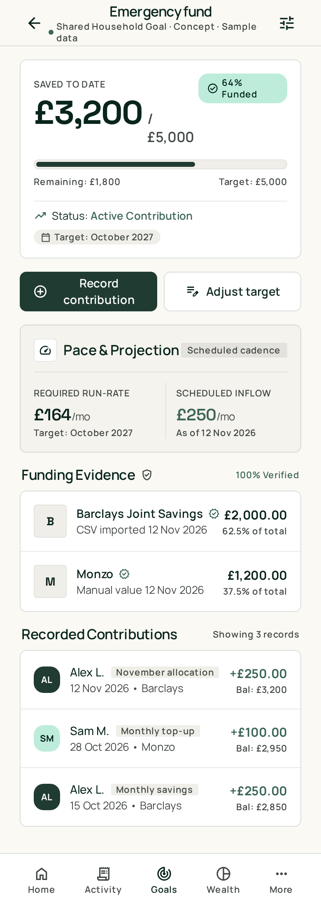

### 12 Record Contribution Form

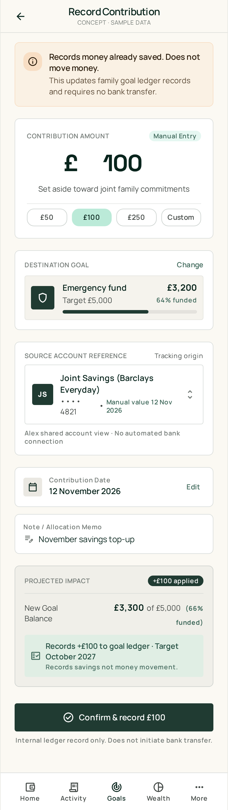

### 13 Wealth Overview

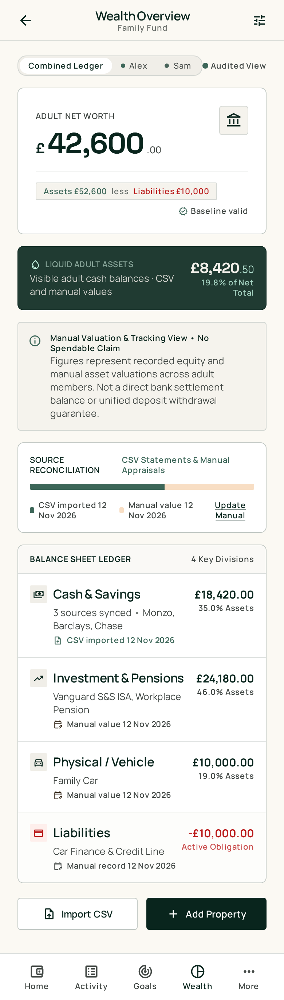

### 14 Projection Scenario

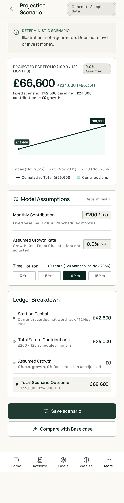

### 15 More / Profile

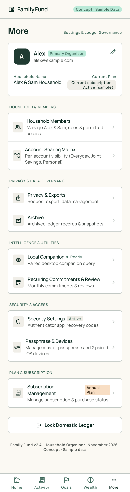

### 16 Household Members

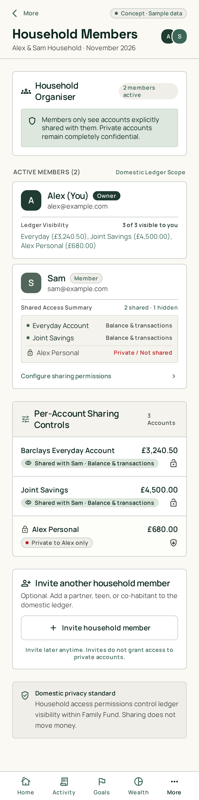

### 17 Privacy and Exports

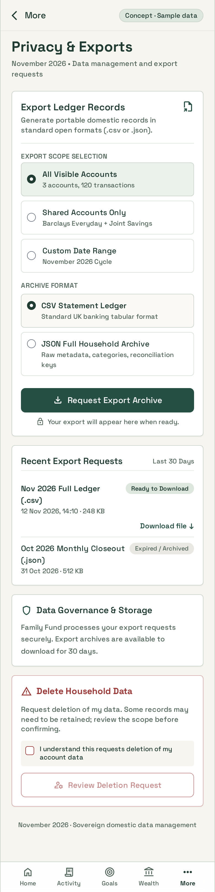

### 18 Local Companion

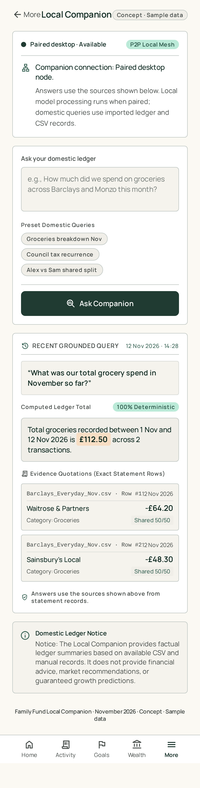

### 19 Subscription Management

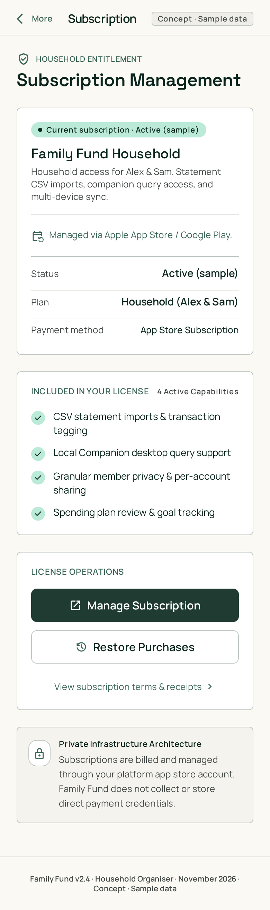

### 20 Welcome / Sign-in

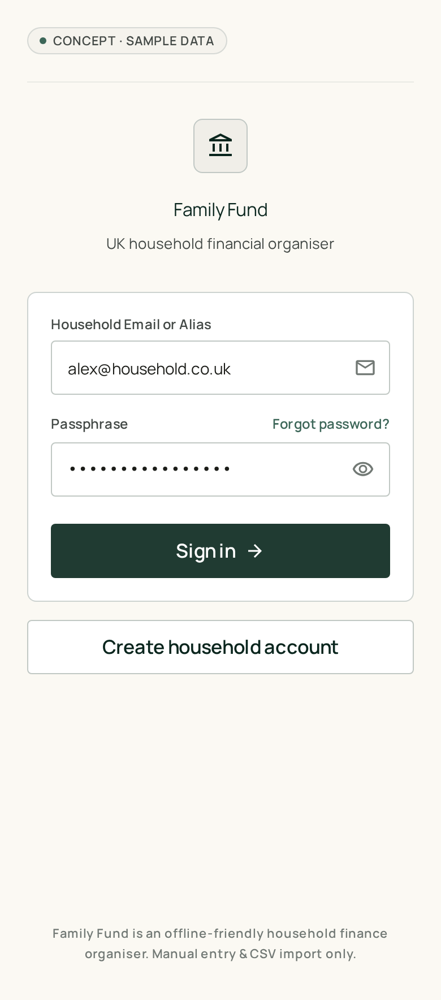

### 21 Verify Identity

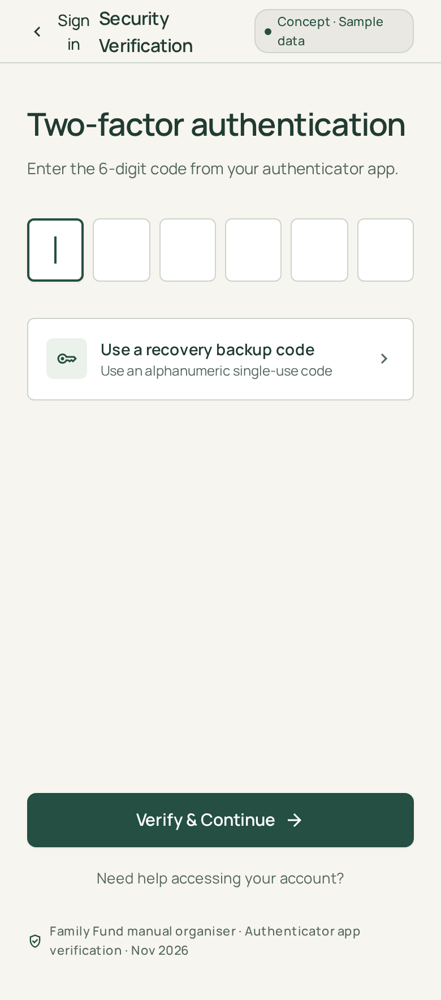

### 22 First Account Setup

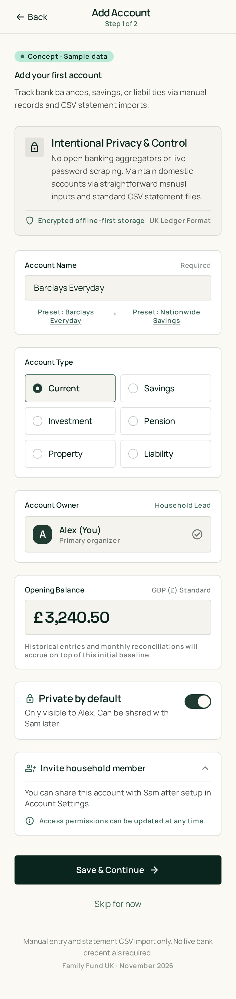

### 23 Account Sharing

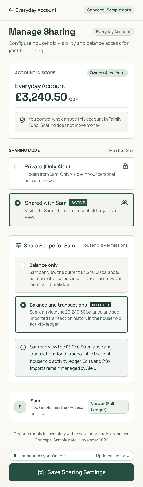

### 24 State Gallery

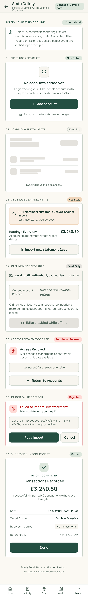

### 25 Security Settings

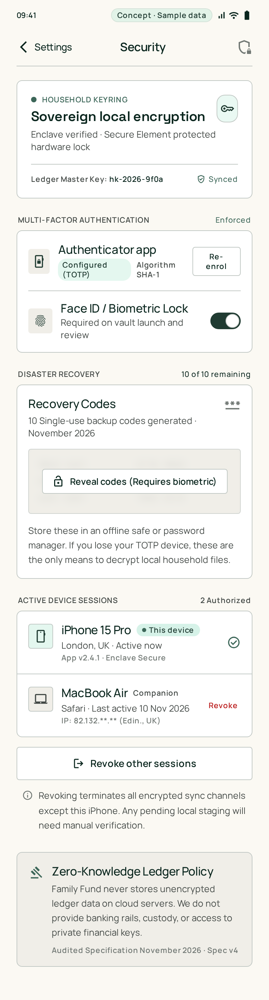

### 26 Account Recovery

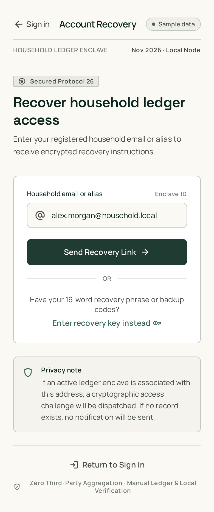

### 27 Archive

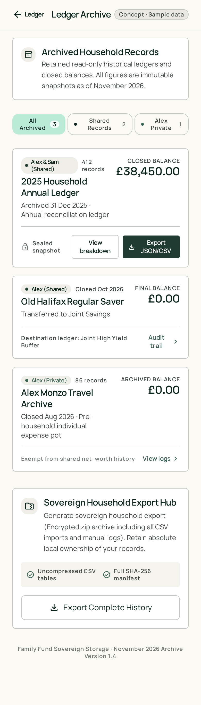

### 28 Import History & Detail

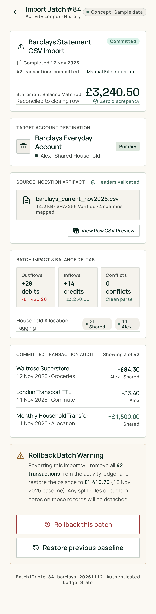

### 29 Split Transaction Editor

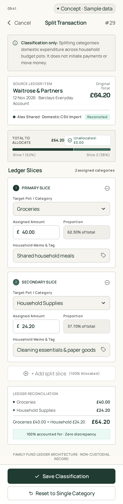

### 30 Goal Funding Review

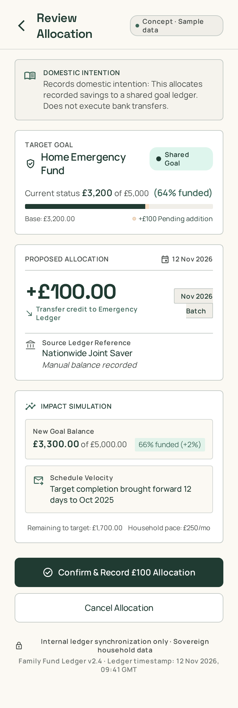

### 31 Update Manual Valuation

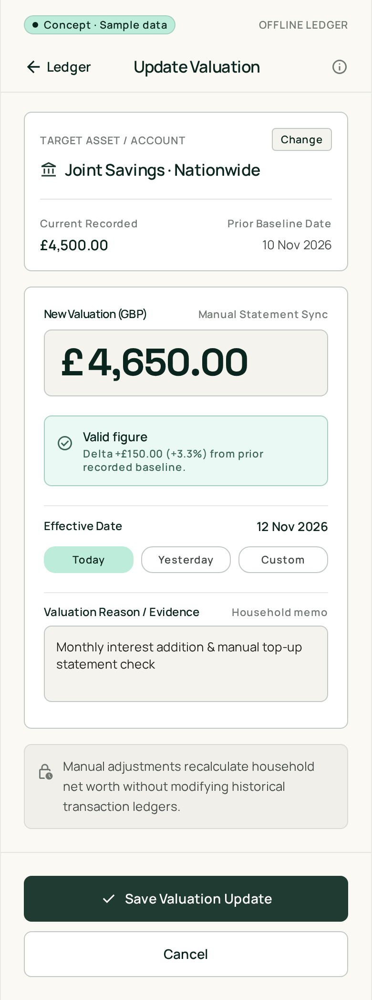

### 32 Create Account / Sign Up

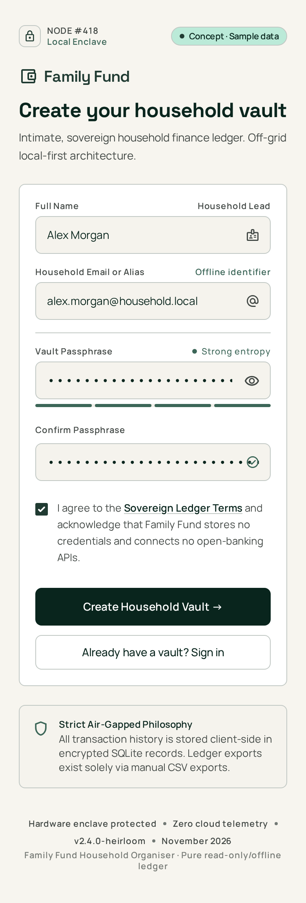
