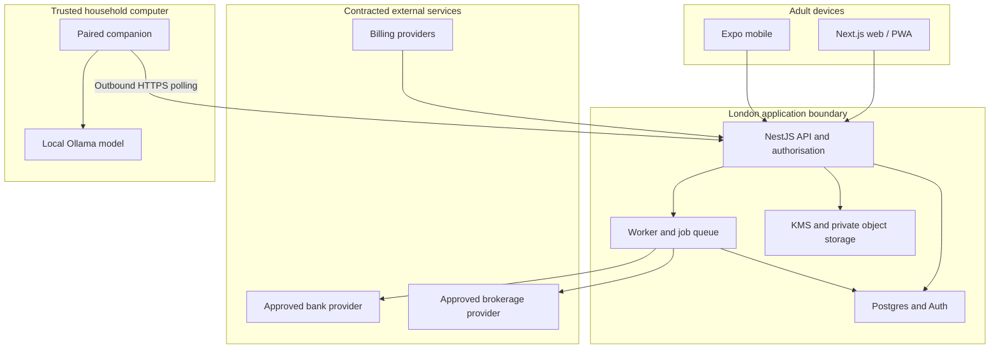

# The Joint App — Architecture, Stack and Project Structure

**Baseline:** 22 October 2026. Read [product specification](01-product-specification.md) first.

**Approach:** A TypeScript modular monolith with an independent worker and local AI companion. Share business logic between web and mobile; retain explicit provider and permission boundaries.

## 1. Recommended stack

| Layer            | Choice                                                        | Reason and boundary                                                           |
| ---------------- | ------------------------------------------------------------- | ----------------------------------------------------------------------------- |
| Web              | Next.js App Router, TypeScript, installable PWA               | Fast founder delivery, responsive layouts, server rendering of public pages   |
| Native mobile    | Expo React Native + Expo Router                               | Native navigation, SecureStore, biometrics and provider deep links            |
| API              | NestJS REST, generated OpenAPI                                | One audited boundary for both clients and background work                     |
| Data             | Supabase-managed PostgreSQL, Prisma                           | Managed backups and auth; ordinary Postgres and migrations remain portable    |
| Authentication   | Supabase Auth                                                 | Maintained identity, MFA and session machinery; no homemade password database |
| Validation       | Zod shared contracts; explicit Nest boundary validation       | Same input definitions, server authoritative                                  |
| Jobs             | PostgreSQL Job + Outbox tables                                | Durable low-volume work without Redis at founder scale                        |
| Money            | BigInt minor units; decimal arithmetic for rates/holdings     | Exact cash calculations and explicit rounding                                 |
| Infrastructure   | AWS London EC2 + S3 + KMS + SES                               | Region choice, VM instance roles, modest initial cost                         |
| Local inference  | Paired Node companion + Ollama on macOS                       | A computer can run a larger local model than a universal mobile baseline      |
| Billing          | Stripe web; store billing on mobile; RevenueCat where adopted | Normalised household entitlements, store-specific purchase rules              |
| Tooling          | pnpm workspaces, Turborepo, ESLint, Prettier                  | Shared contracts and separately deployable apps                               |
| Validation tools | Vitest/Jest, Testcontainers, Playwright, Maestro              | Focus on financial correctness, permissions and critical device flows         |

Pin compatible stable versions and exact lockfiles during Phase 0. The plan intentionally does not invent future-compatible version combinations. Record Node LTS, pnpm, TypeScript, Next, React, Expo SDK/RN, Nest, Prisma, Postgres, Supabase client, Ollama and model digest in a committed version matrix before implementation. Upgrade through a reviewable PR.

## 2. Alternatives and why they are not the default

| Alternative                                  | Useful when                                         | Trade-off                                                                                                                                  |
| -------------------------------------------- | --------------------------------------------------- | ------------------------------------------------------------------------------------------------------------------------------------------ |
| Entirely self-hosted on a household computer | Strictly local storage is the priority              | Remote couple access, consent callbacks, uptime, backup and future SaaS all become harder; a laptop asleep is a service outage             |
| All AWS: Cognito + RDS + ECS/Fargate         | Larger paid deployment needs one operational estate | More infrastructure and IAM work; higher initial fixed cost and authentication integration effort                                          |
| Next.js-only API                             | Very small web-only prototype                       | Quick initially, but native clients, ingestion jobs and local-agent auth still need a stable service boundary; Nest fits the user's skills |

Do not introduce microservices, Kubernetes, a vector database, event streaming or Redis before measurements justify them. A Postgres-backed queue is adequate for the proposed founder workload, subject to testing.

## 3. System boundaries

Trust zones are meaningful: browsers and phones do not hold provider credentials; bank/broker responses are untrusted data; the local companion cannot administer the household; billing callbacks cannot directly expose data.

London is the primary application/database location, not a promise that every vendor control-plane, support, email or payment subprocess occurs in the UK. Maintain the vendor data-flow inventory in the security specification.

## 4. Authoritative service and data flow

1. Client authenticates; Nest validates identity, active session, household membership and account grants.
2. Request context is established from verified identity and server-side membership, never from a client-supplied household ID alone.
3. Application service checks feature entitlement and reads the minimum authorised records.
4. Mutations write domain rows and an outbox event in one database transaction.
5. Worker leases a durable job; a per-connection lock prevents overlapping provider refreshes.
6. Provider adapter fetches and normalises data into staging. Persist each page and its working resume position atomically, but keep the published dataset and stable sync cursor unchanged until the provider-defined update/window is complete. Finalisation publishes the coherent update and its outbox event atomically; a failed/mutated batch restarts according to provider semantics.
7. Aggregates are rebuilt with a dataset version. Screens and scenarios show that version's freshness.
8. A local AI job packages only the requester's permitted data and waits for the paired device.
9. On completion and viewing, recheck permissions. Never treat an old generated narrative as immune to later revocation.

Cloud deterministic calculations remain available while the local model is offline. No data is silently sent to a cloud AI provider.

## 5. Module boundaries

| Nest module  | Owns                                          | Does not own                        |
| ------------ | --------------------------------------------- | ----------------------------------- |
| Identity     | Auth integration, session checks, recovery    | Password hashing implementation     |
| Households   | Membership, invitations, child profiles       | Automatic account sharing           |
| Accounts     | Canonical accounts, ownership, grants         | Provider secrets in public DTOs     |
| Connections  | Consent records, tokens, refresh state        | Trading or payments                 |
| Imports      | CSV preview, commit, rollback                 | Overwriting source evidence         |
| Transactions | Normalised activity, overrides, splits        | Inventing missing source history    |
| Categories   | Default categories, user rules                | Training on other households        |
| Budgets      | Monthly category limits and actuals           | Bank transfer execution             |
| Wealth       | Snapshot valuations, liabilities, holdings    | Market forecasts from an LLM        |
| Goals        | Allocations, schedules, priorities            | Legal ownership of accounts         |
| Projections  | Deterministic, versioned scenarios            | Generated numeric answers           |
| Insights     | Evidence assembly, AI jobs, result validation | Raw SQL or arbitrary tool execution |
| Devices      | Pairing, scoped keys, revocation              | Provider credentials                |
| Entitlements | Household capabilities and billing state      | Account-level authorisation         |
| Privacy      | Export, leave, delete, retention              | Deletion hidden behind billing      |
| Audit        | Security and data-change evidence             | Transaction descriptions in logs    |

Shared domain packages contain pure functions and schemas. Only server packages depend on Prisma, AWS SDK credentials or provider secrets. Enforce package boundaries in lint and build configuration.

## 6. Authentication implementation choice

Use a server-mediated web auth flow so finance tokens are not stored in application localStorage. Next server handlers use the maintained Supabase server SDK; they manage Secure, HttpOnly, SameSite=Lax cookies and token refresh. The web application must not also instantiate a competing browser refresh client. Serialize refresh per session and test multiple tabs. This is a deliberate server-only integration; default browser-assisted Supabase SSR examples do not automatically provide this cookie policy.

Browser finance requests go through `apps/web/app/api/app/[...path]/route.ts`: the server-only BFF reads the HttpOnly auth cookie, enforces CSRF/origin checks and forwards the access token to Nest as a bearer token. Mobile calls Nest with its bearer token directly. Nest does not accept identity fields from a browser body. Validate signature/JWKS, issuer, audience, expiry, user and session identifiers. An application SessionRegistry records blocked sessions and user disabled status. Sensitive operations also check live provider session validity. Deleting an identity or revoking refresh credentials alone is not a substitute for immediate application access revocation.

Mobile uses a maintained native Supabase client with refresh tokens in platform secure storage and access tokens in memory. Both paths resolve to the same AuthContext. Require MFA before real financial connections, exports, new local-device pairing or widening access grants. Reauthentication is recent within five minutes for destructive/credential operations.

See official [Supabase SSR guidance](https://supabase.com/docs/guides/auth/server-side/advanced-guide) and [JWT verification](https://supabase.com/docs/guides/auth/jwts). Phase 1 proves these exact flows; if the chosen SDK cannot satisfy the server-only design, record an ADR before changing it.

## 7. Database access and isolation

- All financial data lives in an unexposed `app` schema; clients never query it through Supabase's Data API.
- Use separate migration-owner, API-runtime and worker-runtime roles. Runtime roles are not superusers, table owners or BYPASSRLS roles.
- Enable and force RLS for tenant tables as defence in depth. For each Prisma transaction, set server-derived household/user context with transaction-local settings.
- Repository queries still require a scoped AuthContext and account capability checks. RLS is not a substitute for those checks.
- TOTALS responses come from a dedicated projection that omits transaction-derived statistics.
- Provider-secret tables are readable only by the connection worker role; API connection setup writes through a narrow credential service.
- No grant to public/anon/authenticated roles for finance tables. Test direct Data API access returns no finance data.
- With a connection pool, context must be transaction-local and cleared by transaction end. Regression tests alternate two households through one pooled connection.

Use a session pooler or direct connection appropriate to a long-lived service; separately configure migration connectivity. Verify current Prisma/pooling guidance at implementation rather than applying generic serverless settings. [Connection documentation](https://supabase.com/docs/guides/database/connecting-to-postgres).

## 8. Jobs and consistency

Canonical Job states: QUEUED, LEASED, SUCCEEDED, RETRY_WAIT, FAILED, CANCELLED. Use `FOR UPDATE SKIP LOCKED`, lease owner, attempt counter, `runAfter` and lease expiry. Worker crash must release work through lease expiry, not data loss.

Each job has a type, idempotency key, household, resource ID and minimal payload. Fetched pages and working resume positions are durable staging, distinct from the stable published cursor. Only a complete provider-defined batch/window advances that cursor and the user-visible dataset. A failed page cannot publish a success timestamp for a full snapshot. Backoff uses jitter and provider Retry-After. Store failed jobs for operator inspection without putting secrets into exception text.

AI jobs add request expiry, device ID, requesting member, grant version and dataset version. Polling devices only see jobs explicitly assigned to them. A queued job is cancelled on member/device revocation. Full parameters are in the AI specification.

## 9. Cloud and environments

**Founder production:** two small Linux ARM hosts in eu-west-2: web/API on a candidate 2–4 GB instance and the connection worker on a 1–2 GB instance. Run resource-limited containers and build ARM-compatible images in CI. Give each host a distinct IAM instance profile and network/DB role; the API can encrypt submitted provider credentials, while only the worker can decrypt the provider-secret key. AI payload and object-storage keys have separate policies. A single shared EC2 profile would not isolate containers and is not the production security design. No static AWS key pair belongs in environment files. EC2 IAM roles provide temporary application credentials. [AWS guidance](https://docs.aws.amazon.com/AWSEC2/latest/UserGuide/iam-roles-for-amazon-ec2.html).

**Database:** Supabase Pro, explicitly select London eu-west-2. Disable public finance schema exposure, enforce TLS and network restrictions where supported. Primary-data location follows the selected region. [Region documentation](https://supabase.com/docs/guides/platform/regions).

**Objects:** private S3 bucket in London for imports and temporary exports; encryption and expiry policies. Do not use a public bucket or permanent public export URL.

**Email:** SES in a supported UK/EU setup, verified domain, SPF/DKIM/DMARC and separate operational templates. Notification contents avoid balances, merchant names and sensitive child details.

**Environments:** local synthetic fixtures, staging with isolated auth/database and provider sandboxes, production with real connections. PR previews use synthetic data only. Never clone production finances into a preview. Separate keys, callback URLs, object buckets and billing modes.

**IaC:** Terraform for AWS network, security groups, EC2 profile, VM, KMS, buckets, SES configuration and alerts. Supabase settings are documented and automated only where current APIs support them. Keep state remote, encrypted and access-controlled; no secrets committed with plans.

## 10. Scaling path

At public launch, retain separate web/API and worker IAM boundaries, and add replicated API nodes behind a load balancer when required by measured load or the availability target. Budget the increase before buying it. Move durable jobs to SQS only once DB queue contention, throughput or independent worker isolation justifies migration. Retain an outbox either way.

Upgrade Postgres compute based on connection use, p95 latency and query plans. Add targeted indexes before replicas. Split ingestion into a separate service only after that boundary has an operational reason. Local inference scales per household device; it is not a shared GPU cluster.

## 11. Explained monorepo structure

Paths are planned repository paths, not claims that application code has already been created.

| Path                                      | Purpose                                                                 |
| ----------------------------------------- | ----------------------------------------------------------------------- |
| `apps/web/app/(public)/`                  | Landing, pricing, privacy, support                                      |
| `apps/web/app/(auth)/`                    | Sign-in, MFA, invitation acceptance                                     |
| `apps/web/app/(app)/`                     | Authenticated dashboard and money routes                                |
| `apps/web/app/api/auth/`                  | Server-managed web auth callbacks and refresh                           |
| `apps/web/app/api/app/[...path]/route.ts` | Same-origin authenticated BFF proxy; no generic upstream URL forwarding |
| `apps/web/components/`                    | Accessible shared web presentation components                           |
| `apps/web/lib/`                           | Server API client, formatting and cache boundaries                      |
| `apps/web/hooks/`                         | Data hooks and interaction helpers                                      |
| `apps/web/providers/`                     | Query, theme and session-state providers                                |
| `apps/web/tests/`                         | Web interaction and route tests                                         |
| `apps/mobile/app/`                        | Expo Router native screens                                              |
| `apps/mobile/src/features/`               | Mobile-specific finance flows                                           |
| `apps/mobile/src/security/`               | Secure storage, lock and deep-link validation                           |
| `apps/api/src/modules/`                   | Domain modules listed above                                             |
| `apps/api/src/common/`                    | Shared request context and result utilities                             |
| `apps/api/src/config/`                    | Typed environment validation                                            |
| `apps/api/src/guards/`                    | Authentication, account scope and entitlements                          |
| `apps/api/src/filters/`                   | Safe API error mapping                                                  |
| `apps/api/src/interceptors/`              | Request IDs, timing and safe audit hooks                                |
| `apps/api/test/`                          | API integration and tenant-isolation tests                              |
| `apps/worker/src/handlers/`               | Ingestion, imports, forecasts, exports and cleanup jobs                 |
| `apps/companion/src/`                     | Pairing, secure keys, polling, Ollama and result upload                 |
| `packages/contracts/src/`                 | Zod DTOs and generated public API types                                 |
| `packages/domain/src/`                    | Pure money, ownership, cash-flow and allocation rules                   |
| `packages/projections/src/`               | Deterministic forecast engine and golden fixtures                       |
| `packages/database/prisma/`               | Schema and reviewed migrations                                          |
| `packages/database/src/`                  | Prisma lifecycle and scoped transaction helper                          |
| `packages/provider-adapters/src/`         | Provider contracts, fixtures and adapters                               |
| `packages/ai-contracts/src/`              | Evidence, intent and validated answer schemas                           |
| `packages/entitlements/src/`              | Capability names and subscription reduction logic                       |
| `packages/design-tokens/`                 | Colours, spacing and typography shared with native                      |
| `packages/test-fixtures/`                 | Synthetic households and provider responses                             |
| `infra/terraform/`                        | Environment infrastructure                                              |
| `scripts/`                                | Seed, restore validation and operational utilities                      |
| `docs/decisions/`                         | ADRs and provider approval records                                      |
| `docs/runbooks/`                          | Recovery and incident procedures                                        |
| `.github/workflows/`                      | Build, test, deploy and release pipelines                               |

The web and mobile UIs share contracts, design tokens and domain logic, not every rendered component. Do not force DOM-based web components into native screens.
